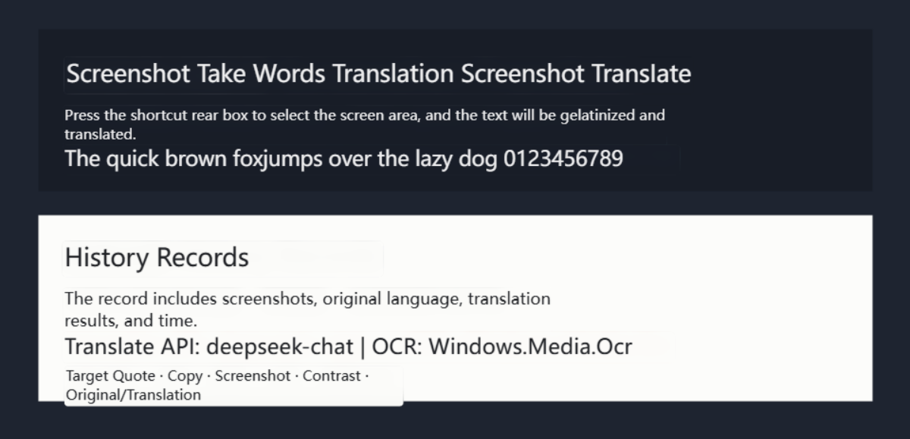
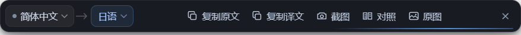
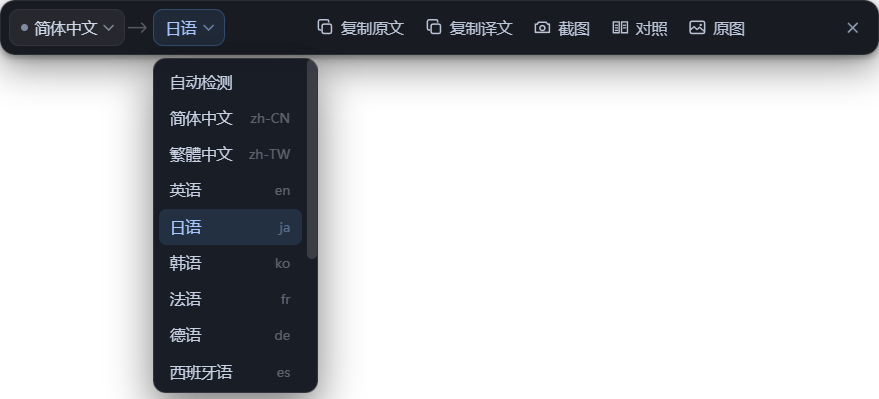
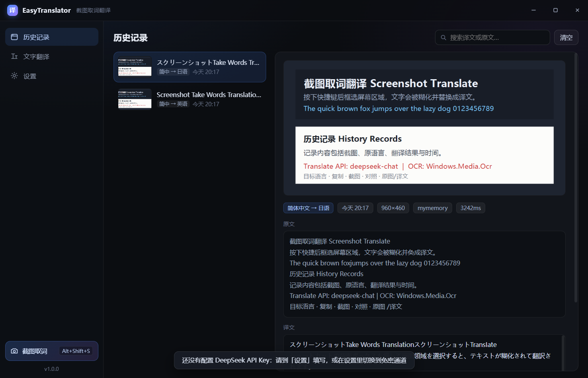
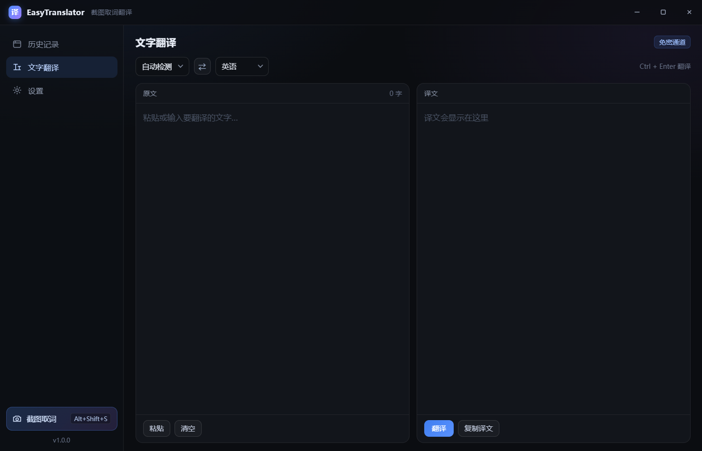
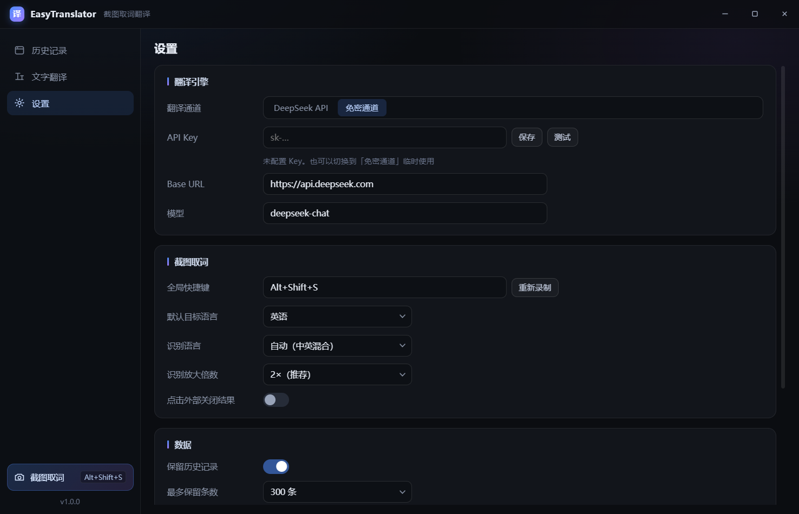

<div align="center">
  
  <h1>EasyTranslator</h1>
  <p><b>截图取词翻译</b> —— 框选屏幕区域，原文被糊化后原位替换成目标语言</p>
  <p>
    
    
    
    
  </p>
</div>

---

一个用来替代网易有道「截图取词翻译」的本地工具。

按快捷键框选屏幕上的任意区域 → 识别其中的文字 → 翻译 → **把原文糊掉，把译文画回原来的位置**。
识别用 Windows 自带引擎（零安装、可离线），翻译接 DeepSeek API，全程只有待翻译文本会发到网络。



<p>
  
  
</p>

## 特性

- **原位替换**：不是弹窗、不是侧边栏，译文直接画在原来的文字位置上，视觉上像"这张图本来就是中文/英文的"
- **智能配色**：逐块采样背景主色，推算出高对比又不突兀的文字颜色，并强制校验对比度 ≥ 5.2
- **字号自适应**：译文永远不超过原文行高，放不下才递减；还会避开相邻文本块，不压字
- **零安装 OCR**：调用 Windows 自带的 `Windows.Media.Ocr`，不需要 Tesseract / PaddleOCR / 任何语言包下载（简体中文 + 英文已内置）
- **快**：常驻 OCR 进程，热调用约 200ms；截图 → 出结果通常在 2 秒内（DeepSeek）
- **历史记录**：每一次取词都留档（截图 / 原语言 / 译文 / 时间），可搜索、回看、复制
- **API Key 加密**：用 Windows DPAPI（`safeStorage`）加密后落盘，不是明文

## 安装

### 方式一：安装包（推荐）

从仓库的 **Releases** 下载 `EasyTranslator-Setup-x.y.z.exe`，双击安装。

- 默认装到当前用户目录 `%LOCALAPPDATA%\Programs\EasyTranslator`，**不需要管理员权限**
- 会自动创建桌面和开始菜单快捷方式，带卸载程序
- 卸载不会删除你的历史记录

### 方式二：便携版

下载 `EasyTranslator-x.y.z-portable.exe`，放到任意目录双击即可，不写注册表。

### 方式三：从源码运行

需要 Node.js 18+（开发时使用 Node 24）。

```bash
git clone <this-repo>
cd easy-translator
npm install

# 双击 start.cmd，或：
npm start
```

> ⚠️ 如果你的环境里存在 `ELECTRON_RUN_AS_NODE=1` 这个环境变量，直接运行 electron 会退化成纯 Node 并报错，
> `start.cmd` 已经帮你清掉了；手动运行时请先 `set ELECTRON_RUN_AS_NODE=`。

### 自己构建安装包

```bash
npm install
npm run dist          # 生成安装包 + 便携版，产物在 dist/
npm run dist:portable # 只生成便携版
```

## 首次配置

1. 启动后会提示：还没配置 API Key。
2. 打开 **设置 → 翻译引擎**，填入 DeepSeek API Key（[platform.deepseek.com](https://platform.deepseek.com/api_keys)），点 **保存**，再点 **测试** 确认连通。
3. 没有 Key 也可以先把「翻译通道」切到 **免密通道**（MyMemory）先体验，质量一般、有每日额度。

`Base URL` 和 `模型` 都可以改，因此也兼容任何 OpenAI 格式的中转服务。

## 使用

### 截图取词

按 <kbd>Alt</kbd> + <kbd>Shift</kbd> + <kbd>S</kbd>（可在设置里改）→ 屏幕暗化 → 拖拽框选 → 自动识别翻译。

选区旁会出现浮动工具条：

| 控件 | 作用 |
| --- | --- |
| `自动 / 语言 ▾` | 当前语言。默认自动判断；选错时可以手动指定，会重新识别 |
| `语言 ▾` | 目标语言。切换后立即重译，并记住为下次的默认值 |
| `复制原文` | 复制识别出的原文 |
| `复制译文` | 复制译文 |
| `截图` | 把当前画面（译文渲染版）另存为 PNG |
| `对照` | 原文小字 + 译文对照显示 |
| `原图 / 译文` | 在原图与译文画面之间切换 |
| `×` | 关闭（也可以 <kbd>Esc</kbd>，或点击窗口外部） |

再次按下同一个快捷键会关闭当前结果层。

### 历史记录

主窗口 → 历史记录。每条记录包含截图、原语言、译文、时间，另外还有原文全文、所用模型和耗时。
支持按原文/译文搜索、查看大图、复制、在文件夹中显示、删除单条、清空全部。



### 文字翻译

主窗口 → 文字翻译，输入后 <kbd>Ctrl</kbd> + <kbd>Enter</kbd>，译文流式输出。

<p>
  
  
</p>

## 技术方案

```
src/
  main/                 主进程
    index.js            启动 / 托盘 / 全局快捷键 / IPC / 窗口生命周期
    capture.js          截图 → 框选 → OCR → 翻译 → 结果层 的完整编排
    ocr.js              Windows OCR 常驻进程的封装
    translate.js        DeepSeek（批量 & 流式）+ 免密通道
    blocks.js           OCR 行 → 段落块的合并算法
    history.js          历史记录与图片存储
    settings.js         配置（API Key 走 safeStorage 加密）
    wins.js             各窗口的创建与工具条定位
    lang.js             语言表
  preload/              4 个隔离的 contextBridge 桥接
  renderer/
    overlay/            全屏框选层（暗化、十字线、尺寸提示）
    result/             结果渲染层（Canvas：糊化 + 排版 + 配色）
    toolbar/            选区旁浮动工具条
    main/               主窗口（历史 / 文字翻译 / 设置）
scripts/
  ocr-worker.ps1        Windows OCR 常驻进程（stdin/stdout 的 JSON 行协议）
  make-icon.ps1         生成应用图标
  make-test-image.ps1   生成 OCR 自测图片
```

几个关键点：

**为什么用 PowerShell 跑 OCR**
`Windows.Media.Ocr` 是 WinRT 接口，Node / Electron 无法直接调用。方案是一个常驻的 Windows PowerShell 5.1 进程：
引擎只初始化一次，之后靠 stdin/stdout 的 JSON 行协议通信，无临时文件、无额外依赖。首次启动会预热，
所以第一次截图也不用等。

**译文怎么画得准**
1. OCR 给出每个词的包围盒 → 按行高、水平重叠度合并成段落块
2. 逐块采样背景主色（颜色直方图取众数后再求均值）
3. 由背景亮度推算文字色，并反复校验对比度直到 ≥ 5.2
4. 字号自适应：从原文单行字高往下二分，直到换行后能装进可用高度
5. 糊化 = 模糊底图 + 背景色高覆盖度填充，再把译文画上去

**踩过的坑**（写下来省得再踩）
- `Windows.Storage.StorageFile.GetFileFromPathAsync` 在 Electron 拉起的子进程里必抛 `E_INVALIDARG`，
  改成 `File.ReadAllBytes` + `InMemoryRandomAccessStream` 就好了
- Windows PowerShell 5.1 会把 `’ “ ‘ ”` 这类弯引号当成字符串定界符，`.ps1` 里千万别直接写
- 无 BOM 的 UTF-8 `.ps1` 会被 PS 5.1 按 GBK 解析，中文注释会把脚本解析坏 → 本仓库的 `.ps1` 一律保留 BOM，
  并在 `.gitattributes` 里标记为 `-text` 防止被转换
- OCR 前放大 2× 能显著提升小字准确率，3× 更准但更慢

## 开发

```bash
npm start            # 正常运行
npm run dev          # 带 DevTools

# 离线校验渲染效果：不截屏、不弹窗，直接拿一张图跑完整流程并自截图
npx electron . --demo=路径\图.png

# 真实截屏链路校验（不显示任何窗口）
npx electron . --democap

# 主窗口三页截图
npx electron . --snap
```

产物输出到 `.tmp/`。打包后的程序不认自定义命令行参数，可以用环境变量触发：
`ET_SNAP=1`、`ET_DEMOCAP=1`、`ET_DEMO=路径`。

## 已知限制

- 只支持 Windows（依赖 `Windows.Media.Ocr` 与 `safeStorage` 的 DPAPI）
- OCR 语言取决于系统已安装的语言包：繁中 / 日语 / 韩语等需要在系统「语言」设置里补装
- 彩色渐变或复杂照片背景上的小字识别率有限，可以把「识别放大倍数」调到 3×
- 免密通道（MyMemory）有每日额度，且是逐条请求，块数多时会比较慢
- 对某些受保护的渲染内容（如部分播放器、部分游戏）截图可能为黑屏
- 没有代码签名证书，安装时 Windows SmartScreen 可能提示"未知发布者"

## 数据与隐私

- 所有截图、识别结果、历史记录都只存在本机 `%APPDATA%\EasyTranslator`
- API Key 用 Windows DPAPI 加密保存，设置界面只显示打码后的片段
- 唯一会发到网络的是**待翻译的文本**，发往你配置的翻译服务（DeepSeek 或免密通道）

## License

MIT
